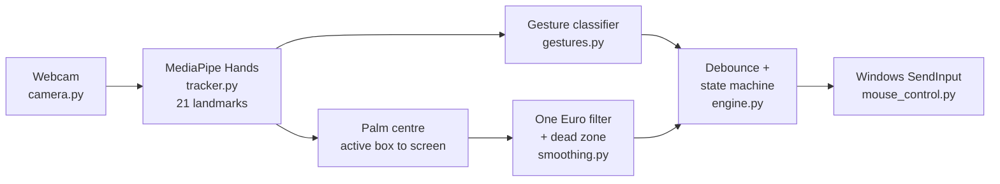

# HandMouse ✋🖱️

**Control the Windows mouse with your hand through a webcam: move, click, drag, scroll, and write by hand on screen.**

I built HandMouse for teaching on screen. With it I can handwrite in any annotation tool (Epic Pen, OneNote,
PowerPoint, Windows Ink) without touching the mouse or a pen tablet. It runs **100 % offline** with
**Python, MediaPipe Hands and OpenCV**, and sends real mouse input through the Windows `SendInput` API.


---

## Gestures

| Hand | Action |
|---|---|
| ✋ Open hand | Move the cursor (the **palm centre** is the cursor point, so it stays steady when your fingers move) |
| 👌 Thumb tip **taps** index tip | **Left click** (the click happens when you let go) |
| 👌👌 Two quick taps | **Double-click** (both clicks land on the same pixel) |
| 👌 Thumb + index **touch and hold** | **Left button held down** → drag, select text, move windows. Let go to release |
| 🤌 Thumb tip touches **middle** tip | **Right click** |
| ✌️ Index + middle up (ring + pinky down) | **Write / draw**: left button held while the pose lasts |
| 🔙 Back of the hand to the camera | **Scroll**, like a joystick: hold the hand higher to keep scrolling up, lower to scroll down. Further away scrolls faster; back at the start line it stops |
| ⏸️ Hand out of view | Pause: nothing moves, and any held button is released |

Right hand by default (left hand or "any" in Settings).

## Features

- **Steady cursor**: One Euro filter + "rope" dead zone + palm-centre tracking. After a click the cursor
  *glides* back to your hand instead of jumping.
- **Precise clicks**: the cursor holds still while your thumb comes in. The click lands where the
  cursor was when the thumb *started* moving, not where the hand drifted to.
- **Touches work from any angle**: the gap between the thumb's and finger's tip bones is measured in the
  image, then checked against the 3D hand shape. In the synthetic tests every touch was found from the
  front up to 75° sideways, with no false clicks from an open hand.
- **Touch calibration (10 s)** fits the click thresholds to *your* hand and camera.
- **Active box**: a small area of the camera image maps to the whole screen, so you need only small arm movements.
  Calibrate it by tracing a comfortable area with your hand.
- **Clean handwriting strokes**: no lost ink at the start of a stroke (the path is replayed after the
  gesture is confirmed) and no tail at the end.
- **Safe**: debounced gestures, the button is released if the hand disappears, and **Esc** is an emergency exit that releases all buttons.
- **Multi-monitor and DPI-aware**, low-light boost, low-CPU mode, live preview window, Tkinter settings UI,
  `settings.json`, global hotkeys, an optional built-in transparent drawing overlay, and a one-file offline `.exe`.
- **37 automated tests** that run without a camera, using synthetic hands and a fake mouse.

## How it works



1. `camera.py` reads the webcam in a thread and always hands over the **newest** frame (low lag).
2. `tracker.py` runs MediaPipe Hands and returns 21 landmarks in 2D (image) and 3D (meters).
3. `gestures.py` measures finger bends in 3D (with hysteresis), thumb-to-fingertip gaps, and whether the palm
   or the back faces the camera, then names the gesture.
4. `engine.py` debounces gestures and runs the logic: tap vs. hold, double-click snapping, the cursor hold
   while the thumb comes in, the aim look-back, joystick scrolling, and releasing the button when the hand is lost.
5. `mouse_control.py` sends absolute mouse input with `SendInput` over all monitors.

## Install (Windows, once, needs internet once)

1. Install **Python 3.11 (64-bit)** from [python.org](https://www.python.org/downloads/windows/) (3.10 also works).
   Tick **"Add python.exe to PATH"** during setup.
2. Download this repository (**Code → Download ZIP**) and extract it to `C:\HandMouse`.
3. Double-click **`setup.bat`**. It creates a private `.venv` and installs `requirements.txt`.
4. Double-click **`run.bat`**.
5. First time only, in the control panel: **Calibrate active box**, then **Calibrate touch (do once)**.

After setup, nothing needs the internet. The hand model is inside the pinned `mediapipe==0.10.21` package.

Manual install:

```bat
py -3.11 -m venv .venv
.venv\Scripts\activate
pip install -r requirements.txt
python main.py
```

## Hotkeys

| Key | Action |
|---|---|
| **F8** | Start / stop tracking |
| **F9** | Show / hide the preview window |
| **F10** | Built-in drawing overlay on / off |
| **Esc** | Emergency exit: releases all mouse buttons and closes the app |

Esc also ends a PowerPoint slide show. You can change any key in **Settings → App & keys** (for example `ctrl+shift+q`).

## Writing in annotation tools

- **PowerPoint slide show:** `Ctrl+P` = pen, `Ctrl+E` = eraser, `E` = erase all. Then ✌️ to write.
- **OneNote:** *Draw* tab, pick a pen, then ✌️.
- **Epic Pen / Windows Ink / Whiteboard:** pick the pen tool, then ✌️.
- **No other tool:** press **F10** for the built-in overlay (colors, eraser, undo, clear).

Tips: rest your elbow, write a bit larger and slower than with a pen, and keep the light in front of you.

## Settings

Everything is in **Settings** (changes apply immediately, **Save** keeps them) and in `settings.json`.

| Setting | Default | Meaning |
|---|---|---|
| `active_box` | x .30, y .45, w .40 | Camera area mapped to the whole screen (use *Calibrate active box*) |
| `cursor_point` | palm | `palm` = palm centre, `index` = index fingertip |
| `min_cutoff` / `beta` / `dead_zone_px` | 0.6 / 0.015 / 4 | Smoothing: lower `min_cutoff` = steadier, higher `beta` = less lag |
| `pinch_on` / `pinch_off` | 0.20 / 0.30 | Thumb–index touch starts / ends (gap ÷ hand size; *Calibrate touch* sets them) |
| `middle_on` / `middle_off` | 0.20 / 0.30 | Same for thumb–middle (right click) |
| `hold_ms` | 400 | Touch held longer than this = left button stays down (drag / select) |
| `tap_frames` | 2 | Frames a tap must last |
| `stable_frames` | 4 | Frames other gestures must last (fewer accidents) |
| `click_freeze_ms` | 300 | Cursor holds still after a click |
| `back_action` | scroll | Back of the hand: `scroll`, `right_click` or `off` |
| `scroll_speed` / `smooth_scroll` | 30 / true | Scroll speed; turn off smooth scrolling if an old app scrolls too fast |
| `monitor` | 1 | 0 = all screens, 1 = main screen, 2+ = other screens |
| `camera_index` / `low_res_mode` | 0 / false | Camera number; low-res mode for slower laptops |
| `hand` | right | `right`, `left` or `any` |

Older gestures (fist click, three-finger scroll, open-palm lock) can be switched back on under **Settings → Gestures**.

## Build a one-file offline `.exe`

Double-click **`build.bat`**. It produces `dist\HandMouse.exe` using PyInstaller (`--onefile --noconsole`).
`--collect-data mediapipe` bundles the hand model files, so the `.exe` works with **no internet**.
If you use a newer MediaPipe, run `python download_model.py` first; `build.bat` then packs
`models\hand_landmarker.task` too. Test it with Wi-Fi turned off.

## Run the tests

The tests need no camera and no MediaPipe. They use synthetic hands and a fake mouse, so they never move your
real cursor. They also run automatically on GitHub Actions.

```bat
.venv\Scripts\activate
pip install pytest
python -m pytest -q
```

They cover gesture recognition (including side views with depth noise), tap / double-tap / hold-drag,
aim accuracy while the hand drifts, no cursor jumps, right click, writing strokes, smooth scrolling,
touch calibration, smoothing, and `settings.json` upgrades.

## Troubleshooting

| Problem | Fix |
|---|---|
| `No matching distribution found for mediapipe` | Use **Python 3.10 or 3.11, 64-bit** |
| `DLL load failed ... _framework_bindings` | Install the **Microsoft Visual C++ Redistributable (x64)** and restart |
| `module 'mediapipe' has no attribute 'solutions'` | `pip install mediapipe==0.10.21`, or run `python download_model.py` |
| `A module compiled using NumPy 1.x cannot be run in NumPy 2` | `pip install numpy==1.26.4` |
| Camera does not open | Close Zoom/Teams/Camera app; Windows Settings → Privacy → Camera → allow desktop apps; try camera 1 |
| Clicks too early / missed | Run **Calibrate touch** again; watch `index` / `middle` at the bottom of the preview |
| Cursor shaky | Settings → Smoothing: *Dead zone* 4 → 5, *min cutoff* 0.6 → 0.5; more light |
| Cannot reach a screen edge | **Calibrate active box** or make the box smaller |
| An app ignores the hand | It runs as administrator: run HandMouse as administrator too |
| Preview says *Ignoring Left hand* | Settings → *Swap left/right labels* |

`handmouse.log` (next to the app) has details for every error.

## Test checklist (with the camera)

Keep the preview open (F9). Its bottom line shows `index`, `middle` (thumb gaps) and `side`.

| Test | Pass when |
|---|---|
| Hold an open hand still for 5 s | Cursor does not wander |
| Tap thumb + index on a desktop icon | Icon selected; cursor did not jump |
| Tap twice quickly on the icon | It opens (double-click) |
| Touch and hold on a title bar, move, let go | Window is dragged, then dropped |
| Touch and hold in a text document, move, let go | Text is selected |
| Thumb + middle on the desktop | One context menu |
| ✌️ write "hello" in OneNote | Smooth letters, no extra dots or tails |
| Back of the hand, hold higher / lower on a long web page | Scrolls up / down smoothly, stops at the cyan line |
| Drop the hand while dragging | Button is released |
| F8, F9, F10, Esc | Work from any app |

## Project structure

```
HandMouse/
├── main.py            Starts everything (settings, hotkeys, engine thread, control panel)
├── engine.py          Main loop + gesture actions (tap / hold / scroll / writing / calibration)
├── gestures.py        Landmarks to gesture: finger bends, thumb touches, palm vs. back
├── smoothing.py       One Euro filter + rope dead zone
├── tracker.py         MediaPipe wrapper (built-in model or hand_landmarker.task)
├── camera.py          Threaded webcam reader (newest frame only)
├── mouse_control.py   Windows SendInput mouse, monitors, DPI awareness
├── config.py          settings.json: defaults, safe ranges, upgrades
├── ui.py              Control panel + Settings window (Tkinter)
├── overlay.py         Optional transparent drawing overlay
├── minimal.py         Stage 1: the smallest working version (good for learning)
├── download_model.py  Model download for new MediaPipe versions
├── tests/             37 pytest tests (synthetic hands, fake mouse)
├── setup.bat / run.bat / stage1.bat / build.bat
└── requirements.txt
```

## Limits

- A single 2D webcam: very fast movements blur, so write at a calm pace.
- Strong backlight (a window behind you) turns your hand into a silhouette, which is the most common cause of problems.
- Apps that run as administrator need HandMouse to run as administrator too.

## Tech stack

Python 3.10/3.11 · MediaPipe Hands · OpenCV · NumPy · Windows `SendInput` (ctypes) · Tkinter · pynput · PyInstaller · pytest · GitHub Actions
